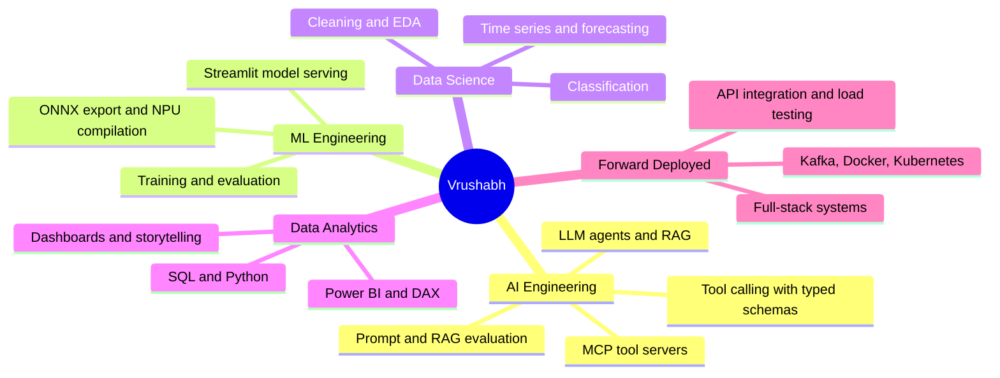
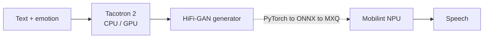
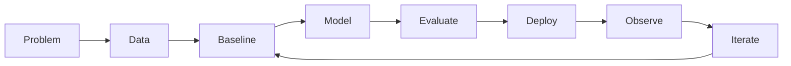

# Vrushabh Bodarya

### AI Engineering · ML Engineering · Data Science · Data Analytics · Forward Deployed Engineering

I build systems that connect data, models and real deployments, from Power BI dashboards to an LLM tool server to a speech model running on an NPU.

M.S. in Applied Data Intelligence, **San José State University**

---

## Where I fit

| Role | What I can show | Proof |
|---|---|---|
| **AI Engineering** | An MCP server exposing typed tools to LLM agents; an LLM travel-planning agent service inside a microservice system; natural-language-to-SQL with fine-tuned LLMs, scored by execution accuracy; prompting-strategy and RAG experiments with measured results | [LLM prompting and WixQA RAG](https://github.com/vrushabh05/llm-prompting-and-enterprise-rag-wixqa), [Tweet emotion and language models](https://github.com/vrushabh05/tweet-emotion-transformers-and-ngram-lm), [mealpilot-mcp](https://github.com/vrushabh05/mealpilot-mcp), [Lab1_distributed_system](https://github.com/vrushabh05/Lab1_distributed_system), [nlquery-genai](https://github.com/vrushabh05/nlquery-genai), [gemma-instruction-tuning-peft](https://github.com/vrushabh05/gemma-instruction-tuning-peft) |
| **ML Engineering** | A trained, evaluated and served classifier; a HiFi-GAN vocoder compiled for the Mobilint NPU, 3.71x faster than CPU in a single-frame benchmark | [Breast cancer risk app](https://github.com/vrushabh05/-Interactive-Breast-Cancer-Risk-Assessment-Using-Machine-Learning-and-Streamlit), [Emotional TTS on the NPU](https://github.com/vrushabh05/emotional-tts-mobilint-npu), [super-resolution labs on the NPU](https://github.com/vrushabh05/super-resolution-npu-deep-learning-labs), [ImageNet-20 CNN](https://github.com/vrushabh05/deep-learning-lab1-imagenet20-cnn), [AlexNet from scratch](https://github.com/vrushabh05/alexnet-imagenet20-from-scratch), [LeNet-5 and Naive Bayes on MNIST](https://github.com/vrushabh05/mnist-lenet5-and-naive-bayes), [CLIP and BLIP on Flickr30k](https://github.com/vrushabh05/clip-blip-multimodal-flickr30k), [LightTTS scaffold](https://github.com/vrushabh05/lighttts-fastspeech2-compression) |
| **Data Science** | Cleaning, EDA, classification with reproducible cross-validation, statistics, Spark ML, XGBoost with Optuna, LSTM and CNN-LSTM time-series forecasting, astronomy image and tabular analysis, Google Trends analysis | [Airline satisfaction](https://github.com/vrushabh05/airline-satisfaction-classification), [Wildfire dynamics](https://github.com/vrushabh05/wildfire-dynamics-prediction), [Bloom filter hash quality](https://github.com/vrushabh05/bloom-filter-hash-quality), [ML fundamentals from scratch](https://github.com/vrushabh05/ml-fundamentals-from-scratch), [Statistics fundamentals](https://github.com/vrushabh05/statistics-fundamentals), [PySpark logistic regression](https://github.com/vrushabh05/pyspark-logistic-regression-rdd-vs-dataframe), [Data cleaning](https://github.com/vrushabh05/Data-Cleaning-and-Preprocessing-Project), [Galactic insights](https://github.com/vrushabh05/Galactic-Insights-Comprehensive-Techniques-in-Astronomical-Data-Image-Processing-and-Normalization), [Google search trends](https://github.com/vrushabh05/Google-Search-Analysis-) |
| **Data Analytics** | Multi-page Power BI reports with forecasting, decomposition and comparison views, plus Python EDA | [Global sales](https://github.com/vrushabh05/Global_Sales_Insights-and-Future-Forecasting-with-PowerBI), [Superstore dashboard](https://github.com/vrushabh05/PowerBI_Walmart_Sales-_Dashboard), [Spotify dashboard](https://github.com/vrushabh05/Spotify-Dashboard), [Superstore EDA](https://github.com/vrushabh05/Exploratory_Data_Analysis_on_Walmart_sales_data) |
| **Forward Deployed Engineering** | End-to-end delivery: React and Node front end, microservices on Kafka, Docker and Kubernetes manifests, JMeter load tests, an LLM agent service | [Lab1_distributed_system](https://github.com/vrushabh05/Lab1_distributed_system) |

---

## Featured work

### Emotional TTS on the Mobilint NPU
Emotion-conditioned speech synthesis (Tacotron 2 + HiFi-GAN). The HiFi-GAN generator was compiled to an NPU executable with Mobilint's toolchain and benchmarked against CPU: **real-time factor 0.0354 on the NPU vs 0.1312 on CPU (3.71x)** on a single-frame benchmark. Group course project, presented to the Mobilint team. [Repository](https://github.com/vrushabh05/emotional-tts-mobilint-npu)

### Super-resolution models on the NPU
Two deep-learning labs where a PyTorch model is exported to ONNX, quantized and compiled for the Mobilint NPU: **LiteSRNet (581K parameters) runs 4.2x faster than CPU at 24.283 dB**, just under its 24.3 dB course target, and **DenoiseSRNet runs 18.3x faster at 22.400 dB**. [Repository](https://github.com/vrushabh05/super-resolution-npu-deep-learning-labs)

### NLQuery: natural language to SQL
Group project comparing LLMs on text-to-SQL by execution accuracy, SQL validity and latency, including a LoRA fine-tune. [Repository](https://github.com/vrushabh05/nlquery-genai)

### Airline satisfaction and wildfire forecasting
Two data-science projects with honest caveats written in the READMEs: random forest and XGBoost reach about 96% accuracy on airline passenger satisfaction (Optuna tuned on the test split, so that number is flagged as optimistic), and LSTM and CNN-LSTM models forecast wildfire detections from MODIS data. [Airline repository](https://github.com/vrushabh05/airline-satisfaction-classification), [wildfire repository](https://github.com/vrushabh05/wildfire-dynamics-prediction)

### CLIP and BLIP fine-tuning on Flickr30k
Zero-shot CLIP retrieval (Recall@1 0.616) and BLIP captioning, then linear probe, partial, LoRA and full fine-tuning compared for each. Partial fine-tuning lifts CLIP Recall@1 to 0.746; full fine-tuning is best for BLIP (BLEU-4 0.294 vs 0.164). Three of the four CLIP adaptations score below zero-shot, and the README says so. [Repository](https://github.com/vrushabh05/clip-blip-multimodal-flickr30k)

### Gemma-2B instruction tuning and PEFT
QLoRA instruction tuning on Dolly-15K and a Sentiment140 comparison of zero-shot, LoRA and a narrow adapter with Optuna: F1 0.689 to 0.862. The README flags a likely evaluation bug in the base-vs-tuned comparison instead of claiming an improvement. [Repository](https://github.com/vrushabh05/gemma-instruction-tuning-peft)

### ImageNet-20 CNN
A 1.2M-parameter CNN trained from scratch on a 20-class ImageNet subset (best validation accuracy 67.3%) and exported to ONNX for the NPU toolchain. [Repository](https://github.com/vrushabh05/deep-learning-lab1-imagenet20-cnn)

### Bloom filter hash quality
A Bloom filter built from scratch to show how hash quality drives the false-positive rate: with good hashing it matches the 0.138 theory (0.141 measured over six seeds), while collisions, dependent hashes, biased distribution and poor avalanche push it to 0.49 to 0.98. [Repository](https://github.com/vrushabh05/bloom-filter-hash-quality)

### LLM prompting and enterprise RAG
Five prompting strategies on two models for Titanic survival, then a FAISS RAG pipeline over the Wix help centre tuned over 16 settings and tested with semantic chunking, reranking and query rewriting. **Zero-shot tied or beat every fancier strategy (gpt-4o 0.808 accuracy)**, and **cross-encoder reranking was the only RAG add-on that helped** (context recall 0.89 to 0.97 on the simulated set), while semantic chunking cut factuality from 0.26 to 0.10. The README lists the small samples and the same-model judge. [Repository](https://github.com/vrushabh05/llm-prompting-and-enterprise-rag-wixqa)

### Tweet emotion and language models
Zero-shot vs fine-tuned DistilBERT and DistilRoBERTa on four-class tweet emotion (0.52 to 0.59 zero-shot, **0.814 fine-tuned**), a typo stress test (2 to 3 points lost), GPT-4o-mini vs Zephyr-7B prompts, and trigram language models where a neural model reaches **402 perplexity against 5,046** for the add-k count model. [Repository](https://github.com/vrushabh05/tweet-emotion-transformers-and-ngram-lm)

### Deep learning from scratch: AlexNet, LeNet-5 and Naive Bayes
AlexNet trained from scratch on a 20-class ImageNet subset (0.560 validation accuracy) with feature-map visualisation, and LeNet-5 on MNIST (**0.9884 test accuracy**) next to Gaussian, Multinomial and Bernoulli Naive Bayes (0.55, 0.83, 0.83). [AlexNet repository](https://github.com/vrushabh05/alexnet-imagenet20-from-scratch), [MNIST repository](https://github.com/vrushabh05/mnist-lenet5-and-naive-bayes)

### ML fundamentals, statistics and Spark
Models written from scratch and checked against scikit-learn (KNN, Naive Bayes with Laplace smoothing, gradient descent, normal-equation regression, tree ensembles), descriptive statistics from first principles, and a PySpark logistic-regression comparison where a controlled rerun showed the notebook's "DataFrame is better" conclusion came from scaling and split differences. [ML fundamentals](https://github.com/vrushabh05/ml-fundamentals-from-scratch), [statistics](https://github.com/vrushabh05/statistics-fundamentals), [PySpark](https://github.com/vrushabh05/pyspark-logistic-regression-rdd-vs-dataframe)

### MealPilot MCP
A Model Context Protocol server with four typed tools (search by name, filter by ingredient, meal details, random meal), Pydantic schemas, result caps and request timeouts. [Repository](https://github.com/vrushabh05/mealpilot-mcp)

### Airbnb distributed system
React + Redux front end, Node.js microservices over Kafka and MongoDB, a FastAPI LangChain agent, Docker and Kubernetes, with JMeter performance tests. [Repository](https://github.com/vrushabh05/Lab1_distributed_system)

### Breast cancer risk assessment
Logistic-regression classifier with a Streamlit interface and radar chart. Reproducible 5-fold cross-validation: **97.4% mean accuracy, 94.4% malignant recall** (educational project, not a medical device). [Repository](https://github.com/vrushabh05/-Interactive-Breast-Cancer-Risk-Assessment-Using-Machine-Learning-and-Streamlit)

### Power BI analytics
Global sales with forecasting and decomposition, a Superstore sales dashboard and a Spotify listening dashboard. See the repositories in the table above.

<b>In development and concepts</b>

- **TactiGraph AI** (in development): graph-based football tactical analysis with an LLM question layer. `Python` `NetworkX` `PyTorch Geometric` `Plotly`
- **Nexus MCP** (in development): multi-tool research agent on the Model Context Protocol, with memory, traces and human approval. `Python` `MCP` `FastAPI` `Pydantic`
- **ContextForge** (prototype): evaluation-first RAG with hybrid retrieval and reranking. `LangChain` `FAISS` `FastAPI`
- **PulseOS** (prototype): wearable-data analytics, forecasting and anomaly detection. Not medical advice.
- **QueryPilot** (prototype): natural language to guarded, read-only SQL analytics.
- **AutoDS Council** (concept): multi-agent data-science workflow with deterministic validation.

---

## Experience

**Data Science Intern / Co-op**, AppStoneLab LLP · Jan 2024 to Dec 2024
Data cleaning and EDA, feature engineering, models with Scikit-learn and XGBoost, cross-validation and tuning, NLP, embeddings, LLMs, LangChain and RAG, Tableau dashboards.

**Data Analyst Intern**, InfoLabz · Jul 2023 to Aug 2023
Analyzed more than 500K network records with Python, SQL, statistics and machine learning: usage patterns, classification and clustering, congestion forecasting, validation and visualization.

---

## Skills

| Area | Tools |
|---|---|
| Data and analytics | Python, SQL, pandas, NumPy, EDA, statistics, time series, Tableau, Power BI, DAX, Matplotlib, Seaborn, Plotly |
| Machine learning | scikit-learn, XGBoost, classification, regression, clustering, forecasting, cross-validation, model evaluation |
| Deep learning and edge | PyTorch, TensorFlow, ONNX, Mobilint NPU toolchain (compile, run, benchmark) |
| Generative AI | LLMs, RAG, embeddings, vector search, LangChain, MCP, prompt and context engineering |
| Engineering | FastAPI, Node.js, React, Kafka, MongoDB, Docker, Kubernetes, AWS, CI/CD |

> Tools listed under learning or experimentation in the concepts above are not claimed as production experience.

### Language mix, refreshed daily

> Measured in bytes of code, which reflects project mix and not skill. Notebooks are excluded.

### GitHub activity

---

## Education

**M.S. in Applied Data Intelligence**, San José State University · Jan 2025 to Dec 2026 · GPA 3.66 / 4.0
Machine Learning on Big Data, Deep Learning, Generative AI, Data Analysis Cycle, Algorithms and Data Structures, Statistics and Forecasting, Cloud Computing, Database Management Systems.

**B.E. in Information Technology**, Gujarat Technological University · Jul 2020 to May 2024 · GPA 9.23 / 10

---

## How I build

I care about systems that are measurable, reproducible and honest about their limits, so each repository states what was measured and how.

---

**Open to roles in** AI Engineering · ML Engineering · Data Science · Data Analytics · Forward Deployed Engineering

[LinkedIn](https://www.linkedin.com/in/vrushabh-bodarya-a36548297/) · [Email](mailto:vrushabhbodaryaait@gmail.com) · [GitHub](https://github.com/vrushabh05)

