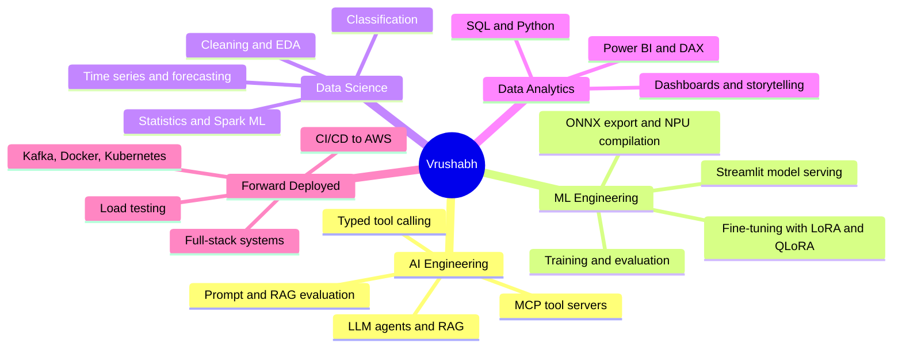
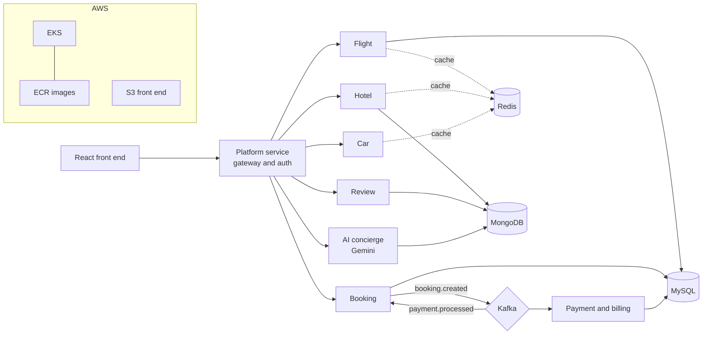
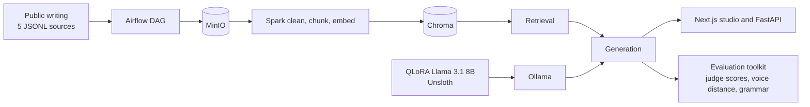
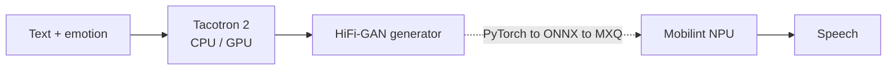
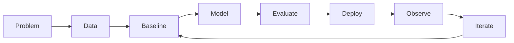

# Vrushabh Bodarya

### AI Engineering · ML Engineering · Data Science · Data Analytics · Forward Deployed Engineering

I build systems that connect data, models and real deployments, from Power BI dashboards to microservices on Kubernetes to a speech model running on an NPU.

M.S. in Applied Data Intelligence, **San José State University**

**Jump to:** [Results](#results-at-a-glance) · [Explore by role](#explore-by-role) · [Team projects](#team-projects) · [More projects](#more-projects) · [Experience](#experience) · [Skills](#skills) · [Education](#education)

---

## Results at a glance

Each number links back to a repository README that shows how it was measured and what it does not prove. Where a result was weaker than expected, the README says so.

---

## Currently working on

| | |
|---|---|
| **Persona RAG** | A team capstone (DATA 298B) on persona-conditioned B2B content generation with retrieval and a QLoRA fine-tuned Llama 3.1 8B. I build the evaluation toolkit and the web front end. [Details below](#persona-rag-qlora-persona-generation-in-progress) |
| **Job search** | Targeting AI Engineering, ML Engineering, Data Science, Data Analytics and Forward Deployed Engineering roles |

---

## Where I fit

---

## Explore by role

Open a role to see the projects that back it.

<b>AI Engineering</b>: MCP servers, RAG, prompting and LLM fine-tuning

| Project | What it shows | Link |
|---|---|---|
| Persona RAG + QLoRA (team, in progress) | Retrieval plus a fine-tuned LLM, with an evaluation toolkit that tests whether the metrics can be trusted | [Details](#persona-rag-qlora-persona-generation-in-progress) |
| LLM prompting and WixQA RAG | Five prompting strategies on two models, then a FAISS RAG pipeline with reranking and query rewriting. Zero-shot tied or beat the fancier prompts; reranking was the only RAG add-on that helped | [Repository](https://github.com/vrushabh05/llm-prompting-and-enterprise-rag-wixqa) |
| NLQuery | Text-to-SQL with several LLMs and a LoRA fine-tune, scored by execution accuracy, SQL validity and latency (team project) | [Repository](https://github.com/vrushabh05/nlquery-genai) |
| Gemma-2B instruction tuning | QLoRA on Dolly-15K and a Sentiment140 comparison of zero-shot, LoRA and a narrow adapter (F1 0.689 to 0.862). The README flags a likely evaluation bug instead of claiming a win | [Repository](https://github.com/vrushabh05/gemma-instruction-tuning-peft) |
| MealPilot MCP | A Model Context Protocol server with four typed tools, Pydantic schemas, result caps and request timeouts | [Repository](https://github.com/vrushabh05/mealpilot-mcp) |
| Tweet emotion and language models | Zero-shot vs fine-tuned transformers vs prompted GPT-4o-mini and Zephyr-7B | [Repository](https://github.com/vrushabh05/tweet-emotion-transformers-and-ngram-lm) |

<b>ML Engineering</b>: training, evaluation, NPU deployment and serving

| Project | What it shows | Link |
|---|---|---|
| Emotional TTS on the Mobilint NPU | Tacotron 2 + HiFi-GAN; the generator compiled for the NPU runs at a real-time factor of 0.0354 vs 0.1312 on CPU (3.71x, single frame). Group project | [Repository](https://github.com/vrushabh05/emotional-tts-mobilint-npu) |
| Super-resolution on the NPU | LiteSRNet (581K parameters) 4.2x faster than CPU at 24.283 dB; DenoiseSRNet 18.3x faster | [Repository](https://github.com/vrushabh05/super-resolution-npu-deep-learning-labs) |
| ImageNet-20 CNN | 1.2M-parameter CNN from scratch, best validation accuracy 67.3%, exported to ONNX for the NPU toolchain | [Repository](https://github.com/vrushabh05/deep-learning-lab1-imagenet20-cnn) |
| CLIP and BLIP on Flickr30k | Linear probe, partial, LoRA and full fine-tuning compared; partial fine-tuning lifts CLIP Recall@1 from 0.616 to 0.746, and three of four CLIP adaptations score below zero-shot | [Repository](https://github.com/vrushabh05/clip-blip-multimodal-flickr30k) |
| AlexNet, LeNet-5 and Naive Bayes | AlexNet from scratch with feature maps; LeNet-5 reaches 0.9884 on MNIST against 0.55 to 0.83 for Naive Bayes variants | [AlexNet](https://github.com/vrushabh05/alexnet-imagenet20-from-scratch), [MNIST](https://github.com/vrushabh05/mnist-lenet5-and-naive-bayes) |
| Breast cancer risk app | Logistic regression behind a Streamlit UI with a radar chart; 5-fold CV 97.4% accuracy, 94.4% malignant recall (educational, not a medical device) | [Repository](https://github.com/vrushabh05/-Interactive-Breast-Cancer-Risk-Assessment-Using-Machine-Learning-and-Streamlit) |

<b>Data Science</b>: statistics, classification, forecasting and Spark ML

| Project | What it shows | Link |
|---|---|---|
| Airline satisfaction | Random forest and XGBoost reach about 96%; the README flags that Optuna tuned on the test split, so the number is optimistic | [Repository](https://github.com/vrushabh05/airline-satisfaction-classification) |
| Wildfire dynamics | LSTM and CNN-LSTM forecasting of wildfire detections from MODIS data | [Repository](https://github.com/vrushabh05/wildfire-dynamics-prediction) |
| ML fundamentals from scratch | KNN, Naive Bayes, gradient descent, normal-equation regression and tree ensembles, each checked against scikit-learn. Re-running showed two claims in the original notebook were wrong, and the README corrects them | [Repository](https://github.com/vrushabh05/ml-fundamentals-from-scratch) |
| PySpark logistic regression | RDD vs DataFrame; a controlled rerun showed the "DataFrame is better" conclusion came from scaling and split differences | [Repository](https://github.com/vrushabh05/pyspark-logistic-regression-rdd-vs-dataframe) |
| Statistics fundamentals | Mean, median, IQR, outlier fences and variance from first principles | [Repository](https://github.com/vrushabh05/statistics-fundamentals) |
| Bloom filter hash quality | Good hashing matches the 0.138 theory (0.141 measured over six seeds); collisions and poor avalanche push it to 0.49 to 0.98 | [Repository](https://github.com/vrushabh05/bloom-filter-hash-quality) |
| Data cleaning, astronomy imaging, Google Trends | Cleaning and EDA projects | [Data cleaning](https://github.com/vrushabh05/Data-Cleaning-and-Preprocessing-Project), [Galactic insights](https://github.com/vrushabh05/Galactic-Insights-Comprehensive-Techniques-in-Astronomical-Data-Image-Processing-and-Normalization), [Google search](https://github.com/vrushabh05/Google-Search-Analysis-) |

<b>Data Analytics</b>: Power BI, DAX, SQL and storytelling

| Project | What it shows | Link |
|---|---|---|
| Global sales | Multi-page Power BI report with forecasting and decomposition | [Repository](https://github.com/vrushabh05/Global_Sales_Insights-and-Future-Forecasting-with-PowerBI) |
| Superstore dashboard | Sales dashboard with comparison views | [Repository](https://github.com/vrushabh05/PowerBI_Walmart_Sales-_Dashboard) |
| Spotify dashboard | Listening dashboard | [Repository](https://github.com/vrushabh05/Spotify-Dashboard) |
| Superstore EDA | Python exploratory analysis of the same sales data | [Repository](https://github.com/vrushabh05/Exploratory_Data_Analysis_on_Walmart_sales_data) |

<b>Forward Deployed Engineering</b>: end-to-end delivery on real infrastructure

| Project | What it shows | Link |
|---|---|---|
| MetaTravelGrid (team) | Eight microservices on Kafka, Redis, MySQL and MongoDB, deployed to AWS EKS with CI/CD, and a load test that measured what each optimisation actually did | [Details below](#metatravelgrid-travel-booking-platform-team-project) |
| Airbnb-style distributed system | React + Redux, Node.js services over Kafka and MongoDB, a FastAPI LangChain agent, Docker, Kubernetes and JMeter tests | [Repository](https://github.com/vrushabh05/Lab1_distributed_system) |
| Persona RAG pipeline | Airflow, Spark, MinIO and Chroma ingestion with a Next.js client (team) | [Details below](#persona-rag-qlora-persona-generation-in-progress) |

---

## Team projects

### MetaTravelGrid: travel booking platform (team project)

A cloud-native flights, hotels and cars booking platform built by a team of six for a distributed systems course (the upstream repository is `kayakteam10/kayak`; mine is a fork). [Repository](https://github.com/vrushabh05/MetaTravelGrid)

- **Architecture.** Eight services behind an API gateway, with the booking and payment flow driven by Kafka events, MySQL and MongoDB side by side, and Redis in front of the search services.
- **Delivery.** Kubernetes manifests for every service, and a GitHub Actions pipeline that builds images, pushes them to ECR, deploys to EKS and publishes the front end to S3.
- **My part.** The user-facing and admin front end: the profile section, payment-card and user-payment pages, the booking and confirmation pages, front-end work on the flight seat map, the admin dashboard and analytics pages, input validation, and the review and auth backend changes. I also wrote scripts that generate test bookings and reviews, and renamed the project from TripWeave to MetaTravelGrid.
- **Teammates.** Sarvesh Waghmare, Mamta Jha, Jenil, Shibin and Mahak Gupta.

**What the load test showed.** The team's own JMeter report (400 concurrent users, 12,000 requests per scenario, 0% errors) found that Redis caching alone made throughput 5.4% *worse* on these simple indexed queries, Kafka added 7.2%, compression added 4.5%, and the full stack was 6.0% faster than the base with P95 latency down from 2,169 ms to 1,765 ms. At 200 users the combined gain was larger (+49%), and at 1,000 users the hotel service returned 503s. The takeaway the report draws is that caching helps slow or complex queries, not trivial indexed ones.

### Persona RAG: QLoRA persona generation (in progress)

Team capstone (DATA 298B, Team 2) on persona-conditioned B2B content generation. The system combines a retrieval pipeline with a QLoRA fine-tuned Llama 3.1 8B, and the team compares architectures with and without retrieval on 120 fixed prompts across blog, LinkedIn, X and talk formats. This is active work: results change as runs are added and not every branch is merged. The repository is owned by a teammate: [andreahcruz/PersonaCloningGen](https://github.com/andreahcruz/PersonaCloningGen).

**My part**
- **Evaluation toolkit** (`eval_tools/`, with tests): confidence intervals and multiple-test correction for comparing two runs, a seed-stability check, a length control for the voice score, a grammar audit and a LanguageTool screen, a fixed-length voice score, and a before/after-RAG metric set.
- **Next.js front end** with a demo mode and a live mode that calls the FastAPI service, plus the API contract the front and back ends agree on.
- **Reliability work**: typed errors with hints, retries, output validation and a health check; fixed an Airflow bug that read only 1,000 documents from the persona store; ran the full pipeline end to end on my laptop (31,443 documents, 38,105 chunks).

**What the evaluation work found so far** (team results as of late October; they may change)
- The voice-distance score depends on text length (correlation -0.66), so longer drafts looked closer to the target author only because they were longer. Re-scoring at a fixed length shrank the apparent "RAG hurts blog voice" gap to roughly zero, which points to a length effect.
- With the comparison rule applied to data where the true difference is zero, a clear difference was wrongly declared 2.7% of the time, within the 5% target.
- In this setup, adding retrieval made the prompt about five times longer (70 to 360 tokens) and added 28 to 33 seconds of evidence extraction per topic, with no measurable quality benefit across three seeds.
- LanguageTool caught 19 of 40 ordinary grammar mistakes (the earlier checker caught 0), but only 14 of its 103 flags on generated drafts were clear mistakes, so it is a screener, not a score.

**Teammates.** Kevin Gao (fine-tuning, retrieval and the Model F experiments), Pukhraj Rathkanthiwar (backend API), and andreahcruz (deployment and integration).

---

## More projects

<b>Short descriptions and caveats for the rest of my repositories</b>

- **Emotional TTS on the Mobilint NPU.** Emotion-conditioned speech synthesis (Tacotron 2 + HiFi-GAN). The HiFi-GAN generator was compiled with Mobilint's toolchain and benchmarked against CPU: real-time factor 0.0354 on the NPU vs 0.1312 on CPU. Group course project, presented to the Mobilint team. [Repository](https://github.com/vrushabh05/emotional-tts-mobilint-npu)

- **Super-resolution models on the NPU.** Two labs where a PyTorch model is exported to ONNX, quantized and compiled for the NPU. LiteSRNet (581K parameters) runs 4.2x faster than CPU at 24.283 dB, just under its 24.3 dB course target. [Repository](https://github.com/vrushabh05/super-resolution-npu-deep-learning-labs)
- **Airline satisfaction and wildfire forecasting.** Honest caveats are written into both READMEs. [Airline](https://github.com/vrushabh05/airline-satisfaction-classification), [wildfire](https://github.com/vrushabh05/wildfire-dynamics-prediction)
- **Power BI analytics.** Global sales with forecasting and decomposition, a Superstore dashboard and a Spotify dashboard (see the Data Analytics role above).

<b>In development and concepts</b>

- **TactiGraph AI** (in development): graph-based football tactical analysis with an LLM question layer. `Python` `NetworkX` `PyTorch Geometric` `Plotly`
- **Nexus MCP** (in development): multi-tool research agent on the Model Context Protocol, with memory, traces and human approval. `Python` `MCP` `FastAPI` `Pydantic`
- **ContextForge** (prototype): evaluation-first RAG with hybrid retrieval and reranking. `LangChain` `FAISS` `FastAPI`
- **PulseOS** (prototype): wearable-data analytics, forecasting and anomaly detection. Not medical advice.
- **QueryPilot** (prototype): natural language to guarded, read-only SQL analytics.
- **AutoDS Council** (concept): multi-agent data-science workflow with deterministic validation.

---

## Experience

**Data Science Intern / Co-op**, AppStoneLab LLP · Jan 2024 to Dec 2024
Data cleaning and EDA, feature engineering, models with Scikit-learn and XGBoost, cross-validation and tuning, NLP, embeddings, LLMs, LangChain and RAG, Tableau dashboards.

**Data Analyst Intern**, InfoLabz · Jul 2023 to Aug 2023
Analyzed more than 500K network records with Python, SQL, statistics and machine learning: usage patterns, classification and clustering, congestion forecasting, validation and visualization.

---

## Skills

| Area | Tools |
|---|---|
| Data and analytics | Python, SQL, pandas, NumPy, EDA, statistics, time series, Tableau, Power BI, DAX, Matplotlib, Seaborn, Plotly |
| Machine learning | scikit-learn, XGBoost, classification, regression, clustering, forecasting, cross-validation, model evaluation |
| Deep learning and edge | PyTorch, TensorFlow, ONNX, Mobilint NPU toolchain (compile, run, benchmark) |
| Generative AI | LLMs, RAG, embeddings, vector search, LangChain, MCP, prompt and context engineering |
| Engineering | FastAPI, Node.js, React, Kafka, MongoDB, Docker, Kubernetes, AWS, CI/CD |

> Tools listed under learning or experimentation in the concepts above are not claimed as production experience.

### Language mix, refreshed daily

> Measured in bytes of code, which reflects project mix and not skill. Most of my Python is written in Jupyter notebooks, so the chart counts the source of every Python code cell as Python and ignores notebook outputs and images. Forks are excluded.

### GitHub activity

---

## Education

**M.S. in Applied Data Intelligence**, San José State University · Jan 2025 to Dec 2026 · GPA 3.66 / 4.0
Machine Learning on Big Data, Deep Learning, Generative AI, Data Analysis Cycle, Algorithms and Data Structures, Statistics and Forecasting, Cloud Computing, Database Management Systems.

**B.E. in Information Technology**, Gujarat Technological University · Jul 2020 to May 2024 · GPA 9.23 / 10

---

## How I build

I care about systems that are measurable, reproducible and honest about their limits, so each repository states what was measured and how.

---

**Open to roles in** AI Engineering · ML Engineering · Data Science · Data Analytics · Forward Deployed Engineering

[LinkedIn](https://www.linkedin.com/in/vrushabh-bodarya-a36548297/) · [Email](mailto:vrushabhbodaryaait@gmail.com) · [GitHub](https://github.com/vrushabh05)

